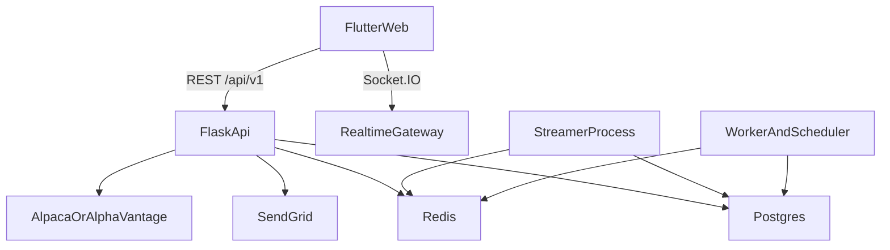

# Alpha Cues MVP Blueprint

## Scope

Create three planning docs in this order:

- [ARCHITECTURE.md](ARCHITECTURE.md)
- [IMPLEMENTATION_PLAN.md](IMPLEMENTATION_PLAN.md)
- [README.md](README.md)

Use these two files as the contract baseline to preserve wherever possible:

- [/Users/sounakchakraborty/Desktop/Test Trades with the new strategy changes - Alpaca/App build help/VVVIII/VVVVIIIII/Operation/MVP Development/README.md](/Users/sounakchakraborty/Desktop/Test%20Trades%20with%20the%20new%20strategy%20changes%20-%20Alpaca/App%20build%20help/VVVIII/VVVVIIIII/Operation/MVP%20Development/README.md)
- [/Users/sounakchakraborty/Desktop/Test Trades with the new strategy changes - Alpaca/App build help/VVVIII/VVVVIIIII/Operation/MVP Development/BACKEND_STRUCTURE.md](/Users/sounakchakraborty/Desktop/Test%20Trades%20with%20the%20new%20strategy%20changes%20-%20Alpaca/App%20build%20help/VVVIII/VVVVIIIII/Operation/MVP%20Development/BACKEND_STRUCTURE.md)

## Canon Decisions To Bake Into The Docs

- Runtime source of truth: one Flask modular monolith, one primary Railway PostgreSQL database, one Redis instance for cache/queue/pub-sub, Flutter Web on Vercel, SendGrid for OTP email.
- Auth ownership: Flask owns email OTP, JWT/refresh flow, auth header contract, and session-expiry behavior. Supabase is excluded from runtime to avoid split auth/database ownership.
- API canon: `/api/v1` is the public target contract; legacy `/api/*` paths from the existing README are documented as backward-compatibility aliases where needed, not repurposed.
- Response envelope canon: keep `{ "success": boolean, "data": ..., "error": ..., "meta": ... }`.
- Field-name canon: preserve `userId`, `avatarUrl`, `timeStamp`, `totalValue`, `totalProfit`, `dayChange`, `BUY`, `SELL`, `ABOVE`, `BELOW`, `PERCENT_CHANGE`, and stable query params like `symbol`, `symbols`, `q`, `timeframe`.
- Database canon: preserve table and column names from the backend structure doc where possible: `users`, `otp_tokens`, `portfolio_event`, `positions`, `portfolio_snapshot`, `stock_tick`, `watchlists`, `watchlist_items`, `alerts`, `notifications`, `feature_flags`.
- Time/number canon: UTC ISO-8601 in API, `TIMESTAMPTZ` in DB, prices/targets on `NUMERIC(18,6)`.
- Realtime canon: REST is source of truth; WebSocket/Socket.IO is incremental/live UX only. After reconnect, client must re-auth if needed, re-subscribe, and refetch a REST snapshot.
- Storage canon for market data: phase 1 uses PostgreSQL-safe schema and rollups; the docs should describe TimescaleDB as an optional non-breaking upgrade path for `stock_tick` and aggregate views if Railway support is enabled.

## Planned Content For ARCHITECTURE.md

- System overview for a modular monolith with modules: `user`, `portfolio`, `market`, `watchlist`, `alerts`, `notifications`, `screener`, `shared`.
- Frontend structure for Flutter Web with feature-first folders, `go_router`, Riverpod provider hierarchy, auth/session lifecycle, token refresh mutex, logout invalidation, route map, and offline/loading/empty/error UX specs.
- Backend structure for Flask app factory, module public service boundaries, adapters for Alpaca/Alpha Vantage/SendGrid, worker/scheduler/streamer process split, and DB-backed feature flags.
- API design with concrete REST and WebSocket contracts, request/response/error shapes, pagination/filter/sort rules, idempotency expectations, and backward-compatibility rules.
- Database design with preserved table names, indexes, relationships, background-job tables/outbox recommendation, and migration/versioning policy.
- Data-flow section describing login, dashboard load, watchlist refresh, alert evaluation, notification delivery, cache lookup, websocket reconnect, and degraded-mode behavior when Redis or upstream providers fail.
- Key technical decisions section that explicitly explains why Flask-owned auth, Redis as non-source-of-truth, API versioning, compatibility aliases, optional Timescale adoption, and feature flags are chosen.

## Planned Content For IMPLEMENTATION_PLAN.md

- Break the build into `Phase 1: MVP foundation`, `Phase 2: core features`, `Phase 3: enhancements`.
- For each phase, split backend and frontend into separate task groups so work is not entangled and can be committed independently.
- For each task, include:
  - step-by-step tasks
  - exact file/module-level breakdown
  - dependencies between tasks
  - targeted tests to add at that step
  - risks/blockers and fallback plan
- Phase 1 should cover repo scaffolding, docker-compose for Postgres/Redis, config/env layout, auth/session contract, feature flags, shared API envelope, observability basics, migrations, local stubs/fakes, and CI/test harness.
- Phase 2 should cover dashboard, watchlists, charts, alerts/notifications, screener, realtime updates, and portfolio events with explicit edge-case handling.
- Phase 3 should cover hardening: performance tuning, backfill jobs, rate-limit tuning, caching refinement, API deprecation workflow, optional Timescale enablement, accessibility polish, and staging/load validation.
- Every feature task should specify unit tests first, then service/contract tests, then widget/E2E tests where they materially reduce regression risk.

## Planned Content For README.md

- Project overview and scope boundaries for the MVP.
- Tech stack summary aligned to the chosen canon.
- Local setup for frontend and backend, including Docker Compose for PostgreSQL + Redis and mock provider modes so the app runs without live Alpaca/Alpha Vantage/SendGrid keys.
- `.env.example` section with backend, frontend, JWT, Redis, Postgres, SendGrid, Alpaca/Alpha Vantage, feature-flag, and mock-mode variables.
- How to run locally, how to run tests, and the basic user flow from login through watchlist, dashboard, alert creation, and notification receipt.
- Explicit notes on edge-case behavior: expired OTP, 5 failed OTP attempts, websocket disconnect, Redis outage, empty watchlists/portfolio, and degraded market-data mode.

## Known Risks To Address In The Docs

- Existing docs conflict on `/api` vs `/api/v1`, OTP auth vs Alpaca-key login, and `timeframe` meaning; the new docs should resolve these without silently breaking old assumptions.
- The older backend structure implies Timescale-specific features; the new plan should preserve schema names while making phase-1 execution safe on standard Railway Postgres.
- Railway realtime scaling requires careful Socket.IO deployment assumptions; the docs should explain single authoritative REST state plus reconnect/replay strategy.
- `totalPrice` semantics and OHLCV vs OHLC contract need to be made explicit so frontend and backend do not drift.
- Feature flags must preserve behavior names exactly and define source-of-truth precedence so future microservice extraction does not change the contract.

