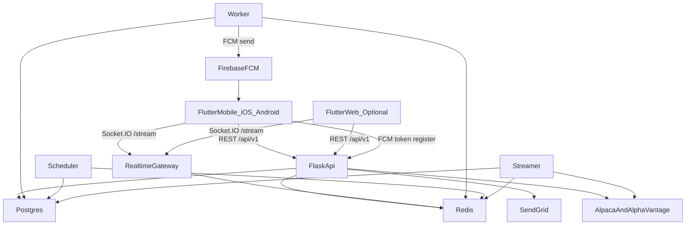

# Alpha Cues MVP Architecture

> **Mobile edition:** Primary client is **native iOS + Android** (App Store / Play Store). Optional Flutter Web remains supported. Full mobile blueprint: `plan.final_mobile.md` and `plan.final_mobile.html`.

## System Overview
Alpha Cues is a production-ready stock market alert and notification MVP built as a **modular monolith**: one Flutter client (**iOS + Android** primary; Web optional), one Flask backend, one primary PostgreSQL database, and one Redis instance for caching, pub-sub, and background-job transport. The system is optimized for fast MVP iteration while remaining safe to operate for roughly **3,000 to 5,000 concurrent users**.

The architecture keeps strict module boundaries:
- one deployable backend application
- one shared database schema, but tables grouped by module ownership
- no module imports another module's internal files directly
- every cross-module call goes through the owning module's exported service API
- feature flags keep runtime behavior swappable without changing the upstream contract

**Deployment topology**
- `frontend-mobile`: Flutter **iOS** (TestFlight → App Store) and **Android** (Play Console → production)
- `frontend-web` *(optional)*: Flutter Web static build on Vercel
- `backend-api`: Flask REST API + Socket.IO gateway on Railway
- `backend-worker`: Celery worker on Railway
- `backend-scheduler`: Celery Beat or APScheduler process on Railway
- `backend-streamer`: dedicated long-lived market-stream consumer on Railway
- `postgres`: single Railway PostgreSQL database
- `redis`: single Railway Redis instance

**External integrations**
- `Alpaca`: real-time price stream and quote/history data
- `Alpha Vantage`: fundamentals and fallback market metadata
- `SendGrid`: transactional OTP email delivery
- `Firebase Cloud Messaging (FCM)`: push to Android; iOS via FCM → APNs
- `Apple Push Notification service (APNs)`: configured in Apple Developer + Firebase

**Operational goals**
- REST is the source of truth; WebSocket is an incremental live-update layer
- all API responses follow a single shared envelope
- feature flags are stored in the `feature_flags` table and can change behavior without deployment
- Redis is treated as a performance layer, not the only source of truth for critical business events
- critical side effects use a database outbox so Redis or worker failures do not silently lose alerts or notifications



**Security and reliability baseline**
- OTP auth with email normalization, hashed OTP storage, expiry, attempt tracking, and lockouts
- short-lived access JWT plus refresh token rotation
- SQLAlchemy and parameterized queries only
- endpoint-specific rate limiting
- structured logs with request IDs
- Sentry-ready error reporting
- health/readiness endpoints and queue-lag monitoring
- retry with exponential backoff for external providers

## Frontend Structure
The frontend is a **Flutter** application (**iOS + Android** primary; Web optional) designed for fast iteration, responsive dashboards, and contract-safe integration with the Flask API. It uses `go_router` for navigation, Riverpod for state management, `dio` for HTTP, and Socket.IO for live quotes and notifications.

### Mobile client (iOS + Android)
- **Navigation:** `BottomNavigationBar` / `NavigationBar` for primary tabs (Dashboard, Watchlists, Alerts, Portfolio); detail routes stack on top.
- **Layout:** `SafeArea` on screens; 48dp minimum touch targets; portrait-first for MVP.
- **Token storage:** `flutter_secure_storage` on mobile (Keychain / EncryptedSharedPreferences); `browser_storage` on Web only.
- **Push:** `firebase_messaging` + `flutter_local_notifications`; register FCM token after login.
- **Deep links:** Universal Links (iOS) + App Links (Android) map to existing `go_router` paths (`/symbols/:symbol`, `/watchlists/:id`, etc.).
- **Toolchain:** Android `compileSdk` / `targetSdk` **36**; iOS deployment target **15.0+**; release builds via `flutter build appbundle` and `flutter build ipa`.
- **Packages:** `firebase_core`, `firebase_messaging`, `flutter_secure_storage`, `flutter_local_notifications`, `connectivity_plus`, `package_info_plus`.

### UI and design system
- font: `Inter`
- primary CTA color: `#7061F3`
- background: `#FFFFFF`
- surface/background-alt: `#F8F9FA`
- uptrend color: green
- downtrend color: red
- spacing: 8px grid
- design direction: modern, clean, investor-friendly, mobile-first, still professional on desktop

### Planned frontend folder structure
```text
frontend/
  lib/
    main.dart
    app/
      app.dart
      router/
        app_router.dart
        route_guards.dart
      theme/
        app_theme.dart
        app_colors.dart
        app_spacing.dart
        app_typography.dart
    core/
      config/
        app_config.dart
      network/
        api_client.dart
        api_envelope.dart
        api_error.dart
        retry_policy.dart
      auth/
        auth_session.dart
        auth_token_store.dart
        auth_interceptor.dart
      realtime/
        socket_client.dart
        socket_events.dart
        quote_subscription_manager.dart
      storage/
        browser_storage.dart          # web
        secure_token_store.dart       # mobile
      push/
        push_service.dart
        push_token_repository.dart
        notification_tap_handler.dart
      widgets/
        app_shell.dart                # web sidebar shell
        mobile_shell.dart             # bottom nav shell
        safe_screen.dart
        loading_skeleton.dart
        empty_state.dart
        error_state.dart
        stale_banner.dart
    features/
      auth/
      dashboard/
      market/
      watchlist/
      alerts/
      notifications/
      portfolio/
      screener/
    test/
  android/
    app/src/main/AndroidManifest.xml
    google-services.json
  ios/
    Runner/Info.plist
    Runner.entitlements
    GoogleService-Info.plist
```

### Navigation and routing map
`go_router` uses path-based URLs and a single authenticated shell route. Public routes stay small; authenticated routes are deep-linkable.

| Path | Screen | Auth | Notes |
|---|---|---|---|
| `/` | redirect | mixed | `/dashboard` if authenticated, else `/login` |
| `/login` | email entry | public | send OTP |
| `/verify-otp` | OTP verification | public | accepts `challengeId` query param |
| `/dashboard` | home dashboard | private | overview, top movers, watchlist summary |
| `/watchlists` | watchlist list | private | empty state includes create CTA |
| `/watchlists/:watchlistId` | watchlist detail | private | prices, add/remove symbols |
| `/symbols/:symbol` | symbol detail | private | chart, quote, fundamentals, alert CTA |
| `/alerts` | alerts and notifications | private | active alerts, history, unread state |
| `/portfolio` | portfolio summary | private | manual holdings for MVP |
| `/screener` | strategy and screener | private | gated by `enable_screener` |
| `*` | not found | mixed | redirect to a safe route |

### Riverpod provider hierarchy
The frontend must avoid tangled auth state. The provider graph is explicit:

1. `appConfigProvider`
   Reads API base URL, feature toggles for local mock mode, and environment settings.
2. `browserStorageProvider` *(web)*
   Owns secure-ish browser storage abstraction for tokens and cached read models.
2b. `secureTokenStoreProvider` *(mobile)*
   Wraps `flutter_secure_storage` for access and refresh tokens.
3. `authRepositoryProvider`
   Talks only to auth endpoints.
4. `authSessionProvider`
   Canonical session state:
   - `null` means logged out
   - `AuthSession` contains access token, refresh token, expiry, and user object
   - methods: `sendOtp`, `verifyOtp`, `refreshTokens`, `logout`
5. `apiClientProvider`
   Injects `Authorization: Bearer <JWT>` for authenticated requests and centralizes error mapping.
6. `socketClientProvider`
   Owns one socket connection per authenticated session.
6b. `pushServiceProvider` *(mobile)*
   Registers FCM token with backend after login; clears on logout.
7. Feature repository providers
   `dashboardRepositoryProvider`, `watchlistRepositoryProvider`, `alertsRepositoryProvider`, `portfolioRepositoryProvider`, `screenerRepositoryProvider`, `marketRepositoryProvider`
8. Feature controller providers
   Own `AsyncValue` screens and mutation flows.

### Token refresh and logout propagation
- Access token expiry returns `401 TOKEN_EXPIRED`
- `dio` interceptor uses a **single-flight refresh lock** so only one refresh request runs at a time
- queued requests wait for that refresh result and replay once on success
- on refresh failure:
  - persisted tokens are cleared
  - socket is disconnected
  - all user-scoped providers are invalidated
  - router redirects to `/login`

### Realtime behavior
- one Socket.IO connection per authenticated session
- namespace: `/stream`
- initial page load always comes from REST
- socket updates only visible symbols plus notification events
- after reconnect, client re-subscribes and refetches REST snapshots before clearing the stale banner
- **mobile app lifecycle:** when the app backgrounds, the OS may suspend the socket; on resume, run the same reconnect + REST refresh path (do not assume a perpetual background websocket)

### Mobile production practices
- **Build flavors:** `dev` / `staging` / `prod` with different `API_BASE_URL` (`--dart-define` or `flutter_flavorizr`); separate Firebase projects per env recommended
- **FCM token hygiene:** backend worker removes stale tokens on FCM `UNREGISTERED` / `INVALID_ARGUMENT`; app updates `last_seen_at` on open
- **Network security:** Android `usesCleartextTraffic="false"`; iOS App Transport Security — no plain HTTP in production
- **Crash reporting:** Firebase Crashlytics or `sentry_flutter` in release builds
- **Offline / connectivity:** `connectivity_plus` drives offline banner; show cached data with stale timestamps; disable unsafe mutations while offline (see state table below)

### Offline, loading, empty, and error states
Every major screen must render one of: loading, data, empty, error, or degraded/offline. Blank screens are not allowed.

| Screen | Loading | Empty | Error | Offline / degraded |
|---|---|---|---|---|
| Dashboard | skeleton cards and chart placeholders | create first watchlist CTA | retry banner plus per-widget fallback | show cached snapshot with stale timestamp |
| Watchlists | list skeleton | "No watchlists yet" | page-level retry | read cached watchlists, disable mutating actions if needed |
| Watchlist detail | row skeletons | "Add symbols to start tracking" | inline row errors plus top retry | stale price badges |
| Symbol detail | chart placeholder | invalid symbol routes to not found | market-data unavailable state | show last known candle and quote timestamp |
| Alerts | list skeleton | "No alerts yet" | form/list errors inline | pause live badge if socket is down |
| Portfolio | holdings skeleton | "No holdings yet" | retry | use last known prices with stale note |
| Screener | filter placeholder and table skeleton | "No matches" after a completed run | preserve filters and show retry | view last saved preset but disable fresh scans |

### Frontend testing approach
- provider tests for auth, refresh locking, and logout invalidation
- widget tests for route guards and major loading/empty/error states
- contract tests that parse committed backend JSON fixtures
- limited Chrome E2E flows for login, watchlist, alerts, and reconnect behavior
- **mobile:** `integration_test/` on emulator/device — login, bottom nav, **deep link cold start** via `getInitialMessage` → `GoRouter.go(deepLink)`
- physical device release smoke: `flutter run --release`

## Backend Structure
The backend is a Flask modular monolith that owns the business contract, auth lifecycle, persistence model, and realtime fan-out. Each module owns its tables, service layer, routes, schemas, and tests. Cross-module access is allowed only through exported service APIs.

### Planned backend folder structure
```text
backend/
  app/
    __init__.py
    extensions.py
    config/
      base.py
      development.py
      production.py
      testing.py
    modules/
      user/
        __init__.py
        routes.py
        service.py
        models.py
        schemas.py
        tests/
      portfolio/
        __init__.py
        routes.py
        service.py
        models.py
        schemas.py
        tests/
      market/
        __init__.py
        routes.py
        service.py
        models.py
        schemas.py
        tests/
      watchlist/
        __init__.py
        routes.py
        service.py
        models.py
        schemas.py
        tests/
      alerts/
        __init__.py
        routes.py
        service.py
        models.py
        schemas.py
        tests/
      notifications/
        __init__.py
        routes.py
        service.py
        models.py
        schemas.py
        tests/
      screener/
        __init__.py
        routes.py
        service.py
        models.py
        schemas.py
        tests/
    shared/
      db.py
      cache.py
      limiter.py
      logging.py
      error_handler.py
      auth.py
      feature_flags.py
      response.py
      pagination.py
      validators.py
      websocket.py
    adapters/
      protocols.py
      market_data.py
      fake_market_data.py
      email_sender.py
      fake_email_sender.py
  migrations/
  worker.py
  scheduler.py
  streamer.py
  wsgi.py
  tests/
```

### Module ownership and public services
- `user`: `UserService`, `SessionService`
- `portfolio`: `PortfolioService`
- `market`: `MarketService`
- `watchlist`: `WatchlistService`
- `alerts`: `AlertsService`, `AlertEvaluationService`
- `notifications`: `NotificationService`
- `screener`: `ScreenerService`
- `shared`: `FeatureFlagService`, `CacheService`, `ResponseFactory`

**Boundary rule**
- allowed: `from app.modules.watchlist.service import WatchlistService`
- not allowed: direct imports into another module's `models.py` or internal helper files

### Process responsibilities
- `backend-api`
  - serves `/api/v1/*`
  - validates JWT
  - serves Socket.IO namespace `/stream`
  - exposes `/health/live` and `/health/ready`
- `backend-worker`
  - sends OTP emails
  - processes outbox events
  - marks notifications delivered
  - sends FCM push when channel includes `PUSH`
  - runs slower async work
- `backend-scheduler`
  - OTP cleanup
  - alert reconciliation
  - cache warmers
  - periodic backfills
- `backend-streamer`
  - owns upstream Alpaca real-time connection
  - normalizes ticks
  - stores latest prices
  - publishes quote updates

### Auth design
Flask owns auth. Supabase is intentionally excluded from the runtime path to keep a single business/API contract and one primary database.

**Flow**
1. user requests OTP with email
2. backend creates or reuses a `users` row and inserts an `otp_tokens` challenge row
3. OTP is hashed at rest and sent by SendGrid
4. user submits OTP plus `otpChallengeId`
5. backend verifies the challenge, enforces attempt limits, issues access and refresh tokens, and returns the canonical user object

**Edge cases**
- OTP expires after 5 minutes
- 5 wrong attempts lock email + IP for 15 minutes
- resend is rate-limited and invalidates previous unused challenge
- generic messaging reduces account enumeration

### Realtime architecture
- client connection: Socket.IO namespace `/stream`
- upstream source: Alpaca quote stream
- internal fan-out: Redis pub-sub for non-critical live updates
- drift correction: client refreshes REST state after reconnect
- durability: alert outcomes and notifications are first written to Postgres before any websocket push

### Reliability design
- Redis cache TTLs:
  - quotes: 3 to 5 seconds
  - watchlist summary: 15 to 30 seconds
  - chart bars: 1 to 5 minutes
  - fundamentals: 1 to 6 hours
- retries:
  - external APIs use exponential backoff with jitter
  - side-effecting tasks must be idempotent
- rate limits:
  - OTP request: `5/minute/IP`, `3/15 minutes/email`
  - OTP verify: lock on the 5th wrong attempt
  - market search: `30/minute/user`
  - batch quote reads capped by symbol count

### Local development without live keys
Use adapters and environment flags:
- `MOCK_EXTERNAL_SERVICES=true`
- `EMAIL_BACKEND=console` or `smtp`
- fake market data fixtures for Alpaca and Alpha Vantage
- console OTP or Mailpit for dev email

This keeps auth and dashboard flows testable before any live provider key is added.

## API Design (Endpoints)
### Canonical API rules
- public base path: `/api/v1`
- auth header: `Authorization: Bearer <JWT>`
- content type: `application/json`
- timestamps: ISO-8601 UTC, example `2026-05-13T17:15:30Z`
- numeric precision:
  - API numbers may be serialized as JSON numbers
  - stored money and price values use `NUMERIC(18,6)`
- ID format:
  - `userId`, `watchlistId`, `alertId`, `notificationId`, `portfolioId` are decimal strings backed by `BIGSERIAL`
  - `eventId` and request IDs are UUID strings
- symbol format:
  - uppercase ticker strings, `^[A-Z][A-Z0-9._-]{0,14}$`

### Response envelope contract
**Success**
```json
{
  "success": true,
  "data": {},
  "error": null,
  "meta": {
    "requestId": "e5f22e08-a2a4-4d82-b8cd-1f7c3e7d1c5f",
    "apiVersion": "1"
  }
}
```

**Error**
```json
{
  "success": false,
  "data": null,
  "error": {
    "code": "OTP_EXPIRED",
    "message": "This code expired. Request a new one.",
    "details": {}
  },
  "meta": {
    "requestId": "e5f22e08-a2a4-4d82-b8cd-1f7c3e7d1c5f",
    "apiVersion": "1"
  }
}
```

### Error contract
| Condition | HTTP | `error.code` |
|---|---:|---|
| invalid input | 422 | `VALIDATION_ERROR` |
| missing or bad JWT | 401 | `UNAUTHORIZED` |
| expired access token | 401 | `TOKEN_EXPIRED` |
| wrong OTP | 401 | `OTP_INVALID` |
| expired OTP | 401 | `OTP_EXPIRED` |
| unknown challenge | 404 | `OTP_CHALLENGE_NOT_FOUND` |
| too many OTP attempts | 429 | `OTP_LOCKED` |
| endpoint rate limited | 429 | `RATE_LIMITED` |
| duplicate symbol in watchlist | 409 | `DUPLICATE_SYMBOL` |
| feature flag disabled | 403 | `FEATURE_DISABLED` |
| upstream timeout | 504 | `UPSTREAM_TIMEOUT` |
| degraded dependency | 503 | `SERVICE_UNAVAILABLE` |

### Auth contract
**JWT claims**
- `sub`: `userId`
- `email`: normalized email
- `sid`: session identifier
- `typ`: `access` or `refresh`
- `iat`, `exp`

**Session policy**
- access token TTL: 15 minutes
- refresh token TTL: 7 days
- refresh rotates on every successful refresh
- refresh failure logs the user out

**Endpoints**
| Method | Endpoint | Notes |
|---|---|---|
| `POST` | `/api/v1/auth/send-otp` | request OTP to email |
| `POST` | `/api/v1/auth/verify-otp` | verify OTP and issue tokens |
| `POST` | `/api/v1/auth/refresh` | refresh access and refresh tokens |
| `POST` | `/api/v1/auth/logout` | revoke session and clear refresh token |
| `GET` | `/api/v1/auth/verify` | verify current access token |
| `GET` | `/api/v1/auth/me` | current user profile |
| `PUT` | `/api/v1/auth/me` | update display name and avatar URL |

**Request and response shapes**
- `POST /api/v1/auth/send-otp`
  - request body: `{ "email": "user@example.com" }`
  - success data:
    ```json
    {
      "otpChallengeId": "8f38ef28-6b85-44c1-b1e5-06658ff52e4f",
      "emailMasked": "u***@example.com",
      "expiresInSeconds": 300
    }
    ```
- `POST /api/v1/auth/verify-otp`
  - request body: `{ "email": "user@example.com", "otpChallengeId": "uuid", "otpCode": "123456" }`
  - success data:
    ```json
    {
      "accessToken": "jwt",
      "refreshToken": "jwt",
      "expiresInSeconds": 900,
      "user": {
        "userId": "123",
        "email": "user@example.com",
        "name": "Alex",
        "avatarUrl": null
      }
    }
    ```

### Market and dashboard contract
**Canonical query parameters**
- `symbol`
- `symbols`
- `q`
- `timeframe`
- `limit`
- `cursor`
- `sort`
- `range`

**Timeframe and range rules**
- `timeframe` means bar granularity only:
  - `5min`, `15min`, `30min`, `1hour`, `1day`, `1week`, `1month`
- `range` means chart period:
  - `1D`, `1W`, `1M`, `3M`, `6M`, `1Y`, `5Y`, `MAX`

**Endpoints**
| Method | Endpoint | Notes |
|---|---|---|
| `GET` | `/api/v1/market/quote?symbol=AAPL` | latest quote |
| `GET` | `/api/v1/market/bars?symbol=AAPL&timeframe=5min&range=1D` | OHLCV bars |
| `GET` | `/api/v1/market/snapshot?symbols=AAPL,TSLA` | batch snapshot |
| `GET` | `/api/v1/market/search?q=apple&limit=10` | search/autocomplete |
| `GET` | `/api/v1/market/movers?sort=gainers&limit=10` | dashboard movers |
| `GET` | `/api/v1/market/fundamentals?symbol=AAPL` | company fundamentals |
| `GET` | `/api/v1/dashboard` | dashboard aggregate payload |

**Bar contract**
```json
{
  "symbol": "AAPL",
  "bars": [
    {
      "timeStamp": "2026-05-13T14:30:00Z",
      "openPrice": 188.120000,
      "highPrice": 189.020000,
      "lowPrice": 187.980000,
      "closePrice": 188.900000,
      "volume": 1823400
    }
  ]
}
```

### Watchlist contract
| Method | Endpoint | Notes |
|---|---|---|
| `GET` | `/api/v1/watchlist` | list watchlists |
| `POST` | `/api/v1/watchlist` | create watchlist |
| `GET` | `/api/v1/watchlist/:id` | watchlist detail |
| `PUT` | `/api/v1/watchlist/:id` | rename watchlist |
| `DELETE` | `/api/v1/watchlist/:id` | delete watchlist |
| `POST` | `/api/v1/watchlist/:id/items` | add symbol |
| `DELETE` | `/api/v1/watchlist/:id/items/:symbol` | remove symbol |

**Domain semantics**
- a `watchlist item` is a unique symbol within one watchlist
- duplicate symbols are rejected with `409 DUPLICATE_SYMBOL`
- watchlists are user-owned only; no shared watchlists in MVP

### Alerts and notifications contract
| Method | Endpoint | Notes |
|---|---|---|
| `GET` | `/api/v1/alerts` | list alerts |
| `POST` | `/api/v1/alerts` | create alert |
| `PUT` | `/api/v1/alerts/:id` | update alert |
| `DELETE` | `/api/v1/alerts/:id` | delete alert |
| `GET` | `/api/v1/alerts/history` | triggered-alert history |
| `GET` | `/api/v1/notifications` | notification feed |
| `PUT` | `/api/v1/notifications/:id/read` | mark read |
| `PUT` | `/api/v1/notifications/read-all` | mark all read |

**Enum contract**
- `action`: `BUY`, `SELL`
- `condition`: `ABOVE`, `BELOW`, `PERCENT_CHANGE`
- `notificationChannel`: `IN_APP`, `EMAIL`, `PUSH`

**Push device registration (mobile)**
| Method | Endpoint | Notes |
|---|---|---|
| `POST` | `/api/v1/devices/register` | Register or update FCM token |
| `DELETE` | `/api/v1/devices/:deviceId` | Unregister on logout |

**Business rules**
- `alert triggered` means the latest evaluated market price crosses the alert threshold from the non-triggered side while the alert is active and outside any cooldown window
- one alert should not generate duplicate notifications for the same evaluation window
- an alert can be re-armed if edited or re-enabled

### Portfolio contract
| Method | Endpoint | Notes |
|---|---|---|
| `GET` | `/api/v1/portfolio` | portfolio summary |
| `GET` | `/api/v1/portfolio/history` | portfolio performance |
| `GET` | `/api/v1/portfolio/transactions` | BUY/SELL event ledger |
| `POST` | `/api/v1/portfolio/event` | record BUY/SELL event |
| `PUT` | `/api/v1/portfolio/event/:id` | edit manual event before settlement window closes |
| `DELETE` | `/api/v1/portfolio/event/:id` | delete manual event if allowed |

**Domain semantics**
- `BUY/SELL event` means a user-recorded portfolio transaction in the MVP, not a broker-executed order
- `portfolio total` / `totalValue` means current marked-to-market value of all current positions
- `availableBalance` is present for contract compatibility and defaults to `0.000000` until cash tracking is introduced

**Portfolio summary shape**
```json
{
  "portfolioId": "12",
  "totalValue": 12500.500000,
  "availableBalance": 0.000000,
  "totalProfit": 500.500000,
  "totalReturn": 4.170000,
  "dayChange": -125.220000,
  "asOf": "2026-05-13T14:30:00Z"
}
```

### Screener contract
| Method | Endpoint | Notes |
|---|---|---|
| `GET` | `/api/v1/screener/strategies` | saved strategies |
| `POST` | `/api/v1/screener/strategies` | save strategy |
| `DELETE` | `/api/v1/screener/strategies/:id` | delete strategy |
| `POST` | `/api/v1/screener/run` | execute a screen |

### Pagination, sorting, filtering, and idempotency
- list endpoints return `meta.nextCursor`
- `limit` defaults to 20, max 100 unless the endpoint documents otherwise
- `sort` uses explicit enums per endpoint, not free-form SQL-like fields
- mutations support an optional `Idempotency-Key` header for retry-safe create operations such as `send-otp`, `create alert`, and `record portfolio event`

### Backward compatibility rules
- `/api/v1` is canonical
- older `/api/*` paths from the current proxy backend can stay as legacy aliases during migration, but no old path is silently repurposed to new semantics
- breaking changes require `/api/v2`
- additive fields are allowed in `v1`
- deprecated fields remain for at least one frontend release window

### Realtime contract
**Namespace**
- Socket.IO namespace: `/stream`

**Client events**
- `subscribe_quotes`
- `unsubscribe_quotes`
- `subscribe_notifications`
- `resume_session`

**Server events**
- `quote_update`
- `notification_new`
- `alert_triggered`
- `connection_state`
- `error`

**`quote_update` payload**
```json
{
  "symbol": "AAPL",
  "lastPrice": 188.900000,
  "changeAmount": 1.240000,
  "changePercent": 0.661200,
  "asOf": "2026-05-13T14:30:01Z"
}
```

**`notification_new` payload**
```json
{
  "notificationId": "456",
  "alertId": "123",
  "title": "AAPL crossed above 190.00",
  "body": "Your AAPL ABOVE alert was triggered.",
  "createdAt": "2026-05-13T14:30:02Z"
}
```

## Database Design
The primary database is PostgreSQL. Table and column names preserve the current backend structure document wherever possible. Schema evolution is additive-first.

### Core module tables
**User and session**
- `users`
  - `user_id BIGSERIAL PRIMARY KEY`
  - `email TEXT NOT NULL UNIQUE`
  - `name TEXT NULL`
  - `avatar_url TEXT NULL`
  - `is_active BOOLEAN NOT NULL DEFAULT TRUE`
  - `created_at TIMESTAMPTZ NOT NULL DEFAULT NOW()`
  - `updated_at TIMESTAMPTZ NOT NULL DEFAULT NOW()`
- `otp_tokens`
  - `id BIGSERIAL PRIMARY KEY`
  - `challenge_id UUID NOT NULL UNIQUE`
  - `user_id BIGINT NOT NULL REFERENCES users(user_id)`
  - `email TEXT NOT NULL`
  - `otp_hash TEXT NOT NULL`
  - `expires_at TIMESTAMPTZ NOT NULL`
  - `used BOOLEAN NOT NULL DEFAULT FALSE`
  - `failed_attempts INTEGER NOT NULL DEFAULT 0`
  - `locked_until TIMESTAMPTZ NULL`
  - `created_at TIMESTAMPTZ NOT NULL DEFAULT NOW()`
- `user_sessions`
  - `session_id UUID PRIMARY KEY`
  - `user_id BIGINT NOT NULL REFERENCES users(user_id)`
  - `refresh_token_hash TEXT NOT NULL`
  - `expires_at TIMESTAMPTZ NOT NULL`
  - `revoked_at TIMESTAMPTZ NULL`
  - `created_at TIMESTAMPTZ NOT NULL DEFAULT NOW()`

**Watchlist**
- `watchlists`
  - `watchlist_id BIGSERIAL PRIMARY KEY`
  - `user_id BIGINT NOT NULL REFERENCES users(user_id)`
  - `name TEXT NOT NULL`
  - `created_at TIMESTAMPTZ NOT NULL DEFAULT NOW()`
- `watchlist_items`
  - `id BIGSERIAL PRIMARY KEY`
  - `watchlist_id BIGINT NOT NULL REFERENCES watchlists(watchlist_id)`
  - `symbol TEXT NOT NULL`
  - `added_at TIMESTAMPTZ NOT NULL DEFAULT NOW()`
  - `UNIQUE (watchlist_id, symbol)`

**Portfolio**
- `portfolio_event`
  - `event_id UUID PRIMARY KEY`
  - `time_stamp TIMESTAMPTZ NOT NULL`
  - `user_id BIGINT NOT NULL REFERENCES users(user_id)`
  - `symbol TEXT NOT NULL`
  - `action TEXT NOT NULL CHECK (action IN ('BUY','SELL'))`
  - `price NUMERIC(18,6) NOT NULL`
  - `volume INTEGER NOT NULL`
- `positions`
  - `user_id BIGINT NOT NULL REFERENCES users(user_id)`
  - `symbol TEXT NOT NULL`
  - `volume INTEGER NOT NULL DEFAULT 0`
  - `total_price NUMERIC(18,6) NOT NULL DEFAULT 0`
  - `updated_at TIMESTAMPTZ NOT NULL DEFAULT NOW()`
  - `PRIMARY KEY (user_id, symbol)`
- `portfolio_snapshot`
  - `user_id BIGINT NOT NULL REFERENCES users(user_id)`
  - `time_stamp TIMESTAMPTZ NOT NULL`
  - `symbol TEXT NOT NULL`
  - `quantity BIGINT NOT NULL`
  - `total_price NUMERIC(18,6) NOT NULL`
  - `PRIMARY KEY (user_id, time_stamp, symbol)`

**Canonical semantics for portfolio math**
- `positions.total_price` means remaining cost basis of the current open quantity
- on `SELL`, the system reduces `total_price` by weighted average cost, not by sale proceeds
- realized P/L is derived separately; this avoids ambiguous cost-basis math

**Market**
- `stock_tick`
  - `symbol TEXT NOT NULL`
  - `time_stamp TIMESTAMPTZ NOT NULL`
  - `open_price NUMERIC(18,6) NULL`
  - `high_price NUMERIC(18,6) NULL`
  - `low_price NUMERIC(18,6) NULL`
  - `close_price NUMERIC(18,6) NULL`
  - `volume BIGINT NULL`
  - `PRIMARY KEY (symbol, time_stamp)`
- rollup views or materialized views
  - `stock_tick_5min`
  - `stock_tick_15min`
  - `stock_tick_30min`
  - `stock_tick_1hour`
  - `stock_tick_1day`
  - `stock_tick_1week`
  - `stock_tick_1month`

Phase 1 uses PostgreSQL-safe tables and materialized views. If TimescaleDB is enabled later on Railway, the same public table and view names remain; only the storage engine and refresh strategy change.

**Alerts and notifications**
- `alerts`
  - `alert_id BIGSERIAL PRIMARY KEY`
  - `user_id BIGINT NOT NULL REFERENCES users(user_id)`
  - `symbol TEXT NOT NULL`
  - `condition TEXT NOT NULL CHECK (condition IN ('ABOVE','BELOW','PERCENT_CHANGE'))`
  - `target NUMERIC(18,6) NOT NULL`
  - `is_active BOOLEAN NOT NULL DEFAULT TRUE`
  - `triggered BOOLEAN NOT NULL DEFAULT FALSE`
  - `cooldown_seconds INTEGER NOT NULL DEFAULT 0`
  - `last_triggered_at TIMESTAMPTZ NULL`
  - `created_at TIMESTAMPTZ NOT NULL DEFAULT NOW()`
- `notifications`
  - `notification_id BIGSERIAL PRIMARY KEY`
  - `user_id BIGINT NOT NULL REFERENCES users(user_id)`
  - `alert_id BIGINT NULL REFERENCES alerts(alert_id)`
  - `title TEXT NOT NULL`
  - `body TEXT NOT NULL`
  - `is_read BOOLEAN NOT NULL DEFAULT FALSE`
  - `created_at TIMESTAMPTZ NOT NULL DEFAULT NOW()`
- additive support tables
  - `alert_trigger_events`
  - `notification_deliveries`
  - `outbox_events`
  - `device_push_tokens` — `device_id`, `user_id`, `fcm_token`, `platform` (`ios`|`android`), `is_active`, `last_seen_at`

**Screener and flags**
- `screener_strategies`
  - saved user-defined screen filters
- `feature_flags`
  - `flag_key TEXT PRIMARY KEY`
  - `is_enabled BOOLEAN NOT NULL DEFAULT FALSE`
  - `description TEXT NULL`
  - `updated_at TIMESTAMPTZ NOT NULL DEFAULT NOW()`

### Required feature flags
Preserve these keys:
- `use_microservice_auth`
- `use_microservice_portfolio`
- `use_microservice_market`
- `enable_live_trading`
- `enable_simulator`
- `enable_screener`

### Indexing strategy
- `idx_users_email`
- `idx_otp_email`
- `idx_otp_expires`
- `idx_user_sessions_user`
- `idx_watchlist_user`
- `idx_watchlist_items_watchlist`
- `idx_positions_user`
- `idx_alerts_user`
- `idx_alerts_active`
- `idx_alerts_symbol_active`
- `idx_notifications_user`
- `idx_notifications_unread`
- `idx_outbox_events_status_next_attempt`

### Data ownership
- `users`, `otp_tokens`, `user_sessions`: auth and identity source of truth
- `watchlists`, `watchlist_items`: watchlist module source of truth
- `portfolio_event`, `positions`, `portfolio_snapshot`: portfolio source of truth
- `stock_tick` and rollup views: market cache and history source of truth inside the monolith
- `alerts`, `alert_trigger_events`: alert definition and trigger source of truth
- `notifications`, `notification_deliveries`: user notification source of truth
- `feature_flags`: runtime behavior control source of truth

### Migration and rollback strategy
- all schema changes are additive first
- destructive changes wait until at least one release after deprecation
- production rollback prefers forward-fix over blind schema downgrade
- contract-breaking API changes require `/api/v2`
- additive field changes preserve existing JSON shape and nullability rules

## Data Flow Diagram
### 1. Login and OTP verification
1. Flutter calls `POST /api/v1/auth/send-otp` with normalized email.
2. Flask checks rate limits and lock status.
3. Flask creates or updates a `users` row and inserts an `otp_tokens` challenge.
4. Worker sends OTP through SendGrid, or console/Mailpit in local mock mode.
5. Flutter calls `POST /api/v1/auth/verify-otp`.
6. Flask validates challenge, expiry, attempt count, and OTP hash.
7. On success, Flask creates `user_sessions`, returns access/refresh tokens, and the client stores them.

### 2. Dashboard load
1. Flutter loads `/dashboard`.
2. Backend returns dashboard aggregates from Postgres plus cached market snapshots.
3. Flutter renders the REST payload immediately.
4. Socket.IO connects to `/stream` and subscribes only to visible symbols.
5. Live quote updates patch the screen without replacing the canonical REST model.

### 3. Watchlist read and symbol updates
1. Flutter requests `/api/v1/watchlist`.
2. Backend returns watchlists and symbol counts from `watchlists` and `watchlist_items`.
3. For detail pages, backend joins watchlist symbols with quote cache and returns current or stale prices.
4. Add/remove symbol mutations invalidate server cache and refresh the corresponding client provider.

### 4. Alert evaluation and notification delivery
1. Streamer receives new Alpaca quotes.
2. Streamer writes current quote cache and publishes lightweight symbol events.
3. Alert evaluator checks active `alerts` for affected symbols.
4. When an alert crosses its threshold:
   - write `alert_trigger_events`
   - insert `notifications`
   - insert `outbox_events`
5. Worker processes the outbox:
   - push websocket notification
   - send email if enabled
   - send FCM push if user has active device token and channel includes `PUSH`
   - mark delivery status

### 4b. Mobile push tap (cold start)
1. User taps push notification while app is terminated.
2. FCM `getInitialMessage` supplies `deepLink` in data payload.
3. App launches, restores session if valid, and `go_router` navigates to the deep link path.

### 5. WebSocket reconnect
1. Client loses socket connection mid-session.
2. Client shows "Live prices reconnecting..." and retries with exponential backoff.
3. On reconnect, client re-authenticates, re-subscribes, and refetches REST snapshots.
4. Client clears the stale banner only after the REST snapshot confirms current state.

### 6. Degraded-mode behavior
- **Redis down**
  - cache is bypassed
  - auth endpoints fail closed if rate-limit state cannot be trusted
  - read-heavy dashboard requests may get slower
  - websocket fan-out becomes degraded
- **SendGrid down**
  - `send-otp` returns a retriable error
  - challenge rows are not consumed until email send succeeds or timeout policy expires
- **Alpaca/Alpha Vantage down**
  - API returns stale cached values where safe
  - websocket may pause
  - dashboard and symbol pages display stale timestamps
- **Postgres unavailable**
  - app returns `503 SERVICE_UNAVAILABLE`
  - readiness endpoint fails

## Key Technical Decisions and Why
| Decision | Choice | Why |
|---|---|---|
| application architecture | modular monolith | simplest deploy and operations model for MVP, while keeping clean module boundaries and an extraction path later |
| auth ownership | Flask-owned email OTP + JWT | avoids split runtime ownership between Flask, Supabase Auth, and a different primary database; keeps one API contract and one source of truth |
| primary database | Railway PostgreSQL | supports the whole MVP with simpler operations than multiple datastores |
| cache and async transport | Redis | enough for caching, queue transport, and lightweight pub-sub at MVP scale |
| realtime transport | Socket.IO namespace `/stream` | robust reconnect on web and mobile; easy Flutter integration |
| client platforms | Flutter iOS + Android (Web optional) | single codebase; native stores for primary MVP delivery |
| push delivery | FCM + APNs via Firebase | alerts when app is backgrounded or killed |
| mobile distribution | App Store + Play Store | standard consumer update channel |
| realtime consistency model | REST authoritative, websocket incremental | prevents drift and makes reconnect/replay behavior predictable |
| market storage | `stock_tick` plus Postgres rollups first, optional Timescale later | safe phase-1 deployment on standard Railway Postgres while preserving future scale-up path |
| feature-flag strategy | `feature_flags` table | changes behavior without deployment and preserves later microservice cutover points |
| shared contract | single response envelope + exact field names | prevents frontend/backend mismatch such as `userId` versus `id` |
| portfolio semantics | `BUY/SELL` events are user-recorded transactions | fits the MVP without brokerage execution or KYC |
| external service strategy | ports/adapters + mock mode | local development should work before live Alpaca, Alpha Vantage, or SendGrid keys exist |
| reliability strategy | DB outbox for critical alerts and notifications | avoids losing critical user-visible events when Redis or workers misbehave |
| migration strategy | additive-first schema changes and `/api/v2` for breaking changes | safest way to evolve the MVP contract without breaking Flutter clients |
