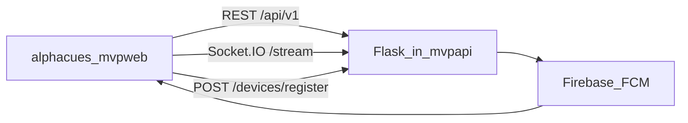

# Alpha Cues — Frontend Architecture (alphacues-mvpweb)

> **Canonical full-stack doc:** [alphacues-mvpapi/ARCHITECTURE.md](https://github.com/AlphaCues-org/alphacues-mvpapi/blob/main/ARCHITECTURE.md)  
> **Mobile blueprint:** [alphacues-mvpapi/plan.final_mobile.md](https://github.com/AlphaCues-org/alphacues-mvpapi/blob/main/plan.final_mobile.md)

Frontend-only summary. API, database, workers, and FCM send logic are in **alphacues-mvpapi**.

## How this app fits the system



- **Auth:** `Authorization: Bearer <JWT>`; `flutter_secure_storage` on mobile
- **Push:** register FCM after login; payload `deepLink` → `go_router`
- **FCM token hygiene (backend):** stale tokens removed on `UNREGISTERED`; `last_seen_at` updated on app open

## Mobile client (iOS + Android)

| Topic | Choice |
|---|---|
| Navigation | `BottomNavigationBar` — Dashboard, Watchlists, Alerts, Portfolio |
| Layout | `SafeArea`, 48dp touch targets, portrait-first |
| Storage | `flutter_secure_storage` |
| Push | `firebase_messaging` + `flutter_local_notifications` |
| Deep links | Universal Links + App Links → `go_router` paths |
| Android SDK | `compileSdk` / `targetSdk` **36** |
| iOS | 15.0+, Push + Associated Domains |
| Images | `cached_network_image` for logos / avatars |
| Crash reporting | Firebase Crashlytics or `sentry_flutter` (release) |

## Build flavors

- `dev` / `staging` / `prod` — different `API_BASE_URL` via `--dart-define` or `flutter_flavorizr`
- Separate Firebase projects per environment recommended

## Network security

- Android: `android:usesCleartextTraffic="false"` in release
- iOS: App Transport Security — **HTTPS only** in production (localhost exception for dev only)

## Folder structure

```text
lib/
  app/router/
  core/network/
  core/auth/
  core/realtime/
  core/push/
  core/platform/connectivity_service.dart
  core/widgets/        # mobile_shell, safe_screen, states
  features/
android/               # Manifest, SDK 36, App Links
ios/                   # entitlements, Universal Links
```

## Routes (`go_router`)

| Path | Screen |
|---|---|
| `/login`, `/verify-otp` | Auth |
| `/dashboard` | Home |
| `/watchlists`, `/watchlists/:id` | Lists |
| `/symbols/:symbol` | Symbol detail |
| `/alerts`, `/portfolio`, `/screener` | Features |

Deep link example: `https://app.alphacues.com/symbols/AAPL`

**Server-side verification (required for links to open the app):**

- Android: host `https://<domain>/.well-known/assetlinks.json`
- iOS: host `https://<domain>/.well-known/apple-app-site-association`

## Riverpod

1. `appConfigProvider` — URLs, flags, flavor  
2. `secureTokenStoreProvider`  
3. `authSessionProvider`  
4. `apiClientProvider` — single-flight refresh  
5. `socketClientProvider`  
6. `pushServiceProvider`  
7. `connectivityServiceProvider` — offline banner (Task 29)  
8. Feature repositories + controllers  

## API contract (summary)

- `/api/v1`, shared envelope, enums `BUY`/`SELL`/`ABOVE`/`BELOW`/`PERCENT_CHANGE`
- Channels: `IN_APP`, `EMAIL`, `PUSH`
- `POST /api/v1/devices/register`

Full list: alphacues-mvpapi **ARCHITECTURE.md → API Design**.

## Realtime (client)

- Namespace `/stream`; subscribe visible symbols only
- **Disconnect:** banner, backoff, re-subscribe, REST refresh before clearing stale state
- **App backgrounded:** OS may suspend socket; on **resume**, same reconnect + REST refresh path as disconnect
- Do not rely on a perpetual background websocket on mobile

## Offline / connectivity UX

- `connectivity_plus` triggers global offline banner
- Per-screen behavior (from master state table):

| Screen | Offline / degraded |
|---|---|
| Dashboard | cached snapshot + stale timestamp |
| Watchlists | cached lists; disable mutations if needed |
| Watchlist detail | stale price badges |
| Symbol detail | last known quote/candle + timestamp |
| Alerts | pause live badge if socket down |
| Portfolio | last known prices + stale note |
| Screener | last preset; disable fresh scan |

## Screen states

Every major screen: **loading, data, empty, error, degraded/offline** — no blank screens.

## Push notifications (FCM)

### Android permission

- **API 33+ (Android 13+):** request runtime **`POST_NOTIFICATIONS`** before showing notifications or channels
- Create notification channel **before** first alert (see IMPLEMENTATION_PLAN Task 25)

### FCM token lifecycle

| Event | Client action |
|---|---|
| Login success | `getToken()` → `POST /api/v1/devices/register` |
| `onTokenRefresh` | Re-register same endpoint with new token |
| Logout | `DELETE /api/v1/devices/:deviceId`; clear local token; cancel refresh listener |
| Backend `UNREGISTERED` | mvpapi worker deactivates token; app re-registers on next open |

### FCM delivery states

| App state | Firebase API | User experience |
|---|---|---|
| **Foreground** | `FirebaseMessaging.onMessage` | In-app banner or local notification via `flutter_local_notifications` |
| **Background** | `onBackgroundMessage` (top-level, `@pragma('vm:entry-point')`) | System notification; data-only handling in isolate |
| **Terminated (cold start)** | `getInitialMessage` | App opens → `GoRouter.go(deepLink)` from payload |
| **Opened from tray** | `onMessageOpenedApp` | Navigate to `deepLink` in data payload |

Payload example: `{ "deepLink": "/symbols/AAPL", "notificationId": "456" }`

### Android notification channel

- Id: `price_alerts` (example)
- Importance: **high**; sound + vibration for price-alert triggers
- Created at app startup in `push_service.dart` before any notification is shown

## Testing

- `flutter test` — providers, widgets, `test/contracts/*` JSON fixtures
- `integration_test/` — login, bottom nav, **cold-start deep link** (`getInitialMessage`)
- `flutter run --release` on physical iPhone + Android device

## When to edit alphacues-mvpapi

New endpoints, response fields, push payload shape, or auth policy → update mvpapi first, then sync fixtures and parsers here.
